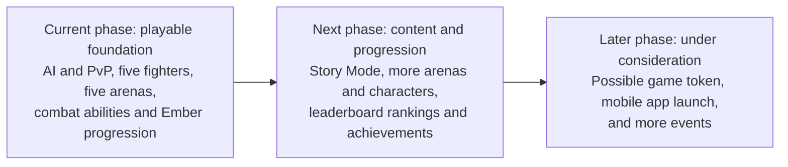

# Veilstrike development roadmap

Veilstrike's current phase establishes a playable 3D dark fantasy fighting game.
Our next phase expands the world and gives players more reasons to return. After
that, we will explore a broader game economy, mobile distribution, and events.

This roadmap is for judges reviewing the current build and our development
direction. Planned features are separate from features available today; no launch
dates have been committed.

## Current phase: what we have built

| Area | Available in the current build |
| --- | --- |
| Playable modes | Quick Match against adaptive AI and private online PvP rooms. |
| Fighters | Five playable characters: Karen, Taren, Nomet, Veyra, and Mawren. Three starter fighters and two unlockable Premium fighters have distinct weapons, signature moves, and ultimates. |
| Combat | One Attack control for light and heavy attacks, movement, sprinting, dodging, guarding, parrying, grabs, and throws. Impacts produce standing staggers; sustained pressure and powerful moves cause knockdowns and recovery. Defeated fighters transition into surrender. |
| Visible abilities | Karen's sword combination, Taren's shield repulse, Nomet's ground slam, Veyra's chained weapon, and Mawren's rune and spell effects. |
| Arenas | Five environments: Ashen Sanctum, Cinder Forge, Drowned Grove, Frostfall Citadel, and the Hollow Rift, with different scenery and atmospheres. |
| Progression | Ember match rewards, character unlocks and upgrades, and a daily Ember spin. Current profile progress is saved on the player's device. |
| Player experience | Character previews, first-time setup, guided tutorials, a game guide, touch controls, an animated opponent reveal, lobby music, combat sounds, and an arena announcer. |
| Lobby roadmap previews | Cards preview Story Mode, more fighters, achievements, and leaderboards. These are announcements of future features. Ember purchasing is also presented as Coming Soon. |

The current phase demonstrates the core fighting experience, character identities,
arena variety, and an initial progression loop. Story Mode, leaderboard rankings,
and achievements are development priorities for the next phase.

## Next phase: world, roster, and player progression

| Priority | What we plan to implement |
| --- | --- |
| Story Mode | A playable narrative experience that develops Veilstrike's world and characters through chapters, objectives, and combat encounters. |
| More arenas | Additional arenas with their own layouts, scenery, and atmosphere, expanding beyond the five environments in the current build. |
| More characters | New fighters with distinct appearances, weapons, fighting styles, signature abilities, ultimates, and visible skill animations. |
| Leaderboard rankings | Player rankings connected to match performance, with a clear scoring system and trustworthy result tracking. |
| Achievements | Trackable combat, progression, and exploration milestones, with visible achievement cards and completion feedback. |

The goal of this phase is to turn the current arena-fighting foundation into a
larger experience with narrative content, greater variety, and lasting progression.

## Later phase: economy, mobile, and events

These directions are under consideration after the next gameplay phase. Their
implementation and release scope will depend on player feedback and feasibility.

| Direction | What we are considering |
| --- | --- |
| Possible game token | Explore launching a token for the game economy, particularly for purchasing Embers and other in-game purchases. Its role and relationship to Embers are still to be defined. No token or token purchasing integration is available in the current build. |
| Mobile app launch | Evaluate a dedicated mobile app release, building on the existing touch controls with mobile performance, interface, and distribution work. A native mobile app has not launched. |
| More events | Expand recurring challenges, themed events, and competitive gatherings to give players new activities and reasons to return. |

## Development sequence

The standalone Mermaid diagram is available in
[development-roadmap.mmd](development-roadmap.mmd).
